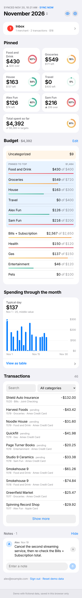

# Sundialed Finance

A household budget app for two people: a phone-first, installable web app that mirrors a shared Google Sheet into a database and turns it into monthly targets, spending trends, and a few gentle nudges.

**[Live demo](https://karenweston.github.io/sundialed-finance/)** (fictional data, saved in your browser only. Sign in with any email and password.)



## Why I built it

The budget already lived in a Google Sheet that both of us trusted. What was missing was a quick answer to "how are we doing this month?" on a phone, without opening a spreadsheet. Sundialed keeps the Sheet as the source of truth and adds a read-mostly view on top of it, with the security of the data as the first design constraint.

## What it does

- **This month at a glance.** Pinned category tiles, a total against targets, and rows that turn amber and red as a category approaches or passes its target.
- **Spending through the month.** A daily chart with a typical-day figure; tap a bar for the exact number.
- **Inbox for uncategorized merchants.** Save a mapping once (exact or "contains", optionally limited to an account) and past and future charges are filed automatically.
- **Targets that change over time.** Edit a target from the app; a new month starts as a copy of the previous one.
- **Month locks.** Freeze a past month so later edits can't change its totals.
- **Notes per month**, for things to talk through together.
- **Apple Card CSV import**, de-duplicated against what the Sheet already has.
- **Phone notifications** at 50, 75 and 90 percent of a target, when over, and a weekly check-in. Words only, never dollar amounts.
- **Privacy toggle** that hides every amount on screen.

## Two ways to run it

| | Demo (this site) | Live |
| --- | --- | --- |
| Data | Fictional, generated at load | Your Google Sheet, synced on a schedule |
| Backend | None; `src/lib/demo/` fakes it in the browser | Supabase: Postgres with row-level security, edge functions |
| Auth | Any email and password | Email and password, closed sign-ups, allow-list |
| Notifications | Off | Web push from the sync function |

Demo mode is a build flag (`VITE_DEMO=true`). The app talks to one `supabase` client module; in demo mode that module returns a small in-browser implementation of the calls the app makes (auth, a chainable table query builder, and two edge functions), backed by `localStorage` and seeded with invented merchants and amounts. The UI code is identical in both modes.

```
Live:   Google Sheet (read-only) -> Supabase edge function (scheduled) -> Postgres (RLS) <- web app
Demo:   generated sample data -> localStorage <- web app
```

## Stack

React 19, TypeScript, Vite, a service worker for the offline shell and push, Supabase (Postgres, edge functions, auth), Vitest. The budget math (`supabase/functions/_shared/`) is pure and shared by the app and the server, with unit tests.

## Under the hood

The demo site runs the front end against an in-browser stand-in, so the backend below isn't exercised there. It is all in this repo to read, and the logic it depends on is unit-tested.

| Piece | Where | What it does |
| --- | --- | --- |
| Database | `supabase/migrations/` | 14 migrations, 13 tables, 26 row-level security policies. Every table is locked to an allow-list of signed-in users. |
| Sheet sync | `supabase/functions/sync-sheet/` | Edge function (Deno) that reads the Google Sheet through the Sheets API with a service account and a read-only token, normalizes messy rows, and runs on a schedule with `pg_cron`. |
| Writes back | `update-target/`, `sync-now/` | Edge functions that verify the caller is allowed, then make narrow, validated writes to the Sheet. They refuse if the tab layout isn't what they expect. |
| Notifications | `sync-sheet/notify.ts`, `src/sw.js` | Web Push with VAPID keys and a service worker. Threshold alerts go out once per month per category. |
| Auth | `src/Login.tsx`, migrations | Supabase Auth with email and password. Sign-ups are closed twice: in the dashboard and by a database trigger. |
| CI/CD | `.github/workflows/deploy.yml` | Runs the tests, builds, and publishes to GitHub Pages on every push. |
| Tests | `*.test.ts` | 101 tests across budget math, bank-row parsing, categorization rules, alerts, target edits and the demo backend. |

---

# Running your own live copy

The rest of this file is the setup for a real deployment against your own Sheet and Supabase project. None of it is needed for the demo.

## Security model

- Every read of the Sheet uses a **read-only** Google token. The only writes are appending imported Apple Card rows to the `AppleCard` tab and changing targets on the `Targets` tab: it uses a separate short-lived edit token, requested only when rows are waiting, and the code writes only to empty rows below the last transaction in columns B–D and F–H (never the formula column). It refuses if the tab layout has changed. To turn writing off, share the Sheet with the service account as Viewer instead of Editor; imports then stay in the app.
- Every table has row-level security. A signed-in user can read data only if their email is in `allowed_users`.
- The browser can write to `vendor_rules` (app-side merchant mappings), `month_locks` (frozen month snapshots), `app_settings` and `apple_imports` (rows from an Apple Card CSV; it can set only the transaction columns, never `pushed_at`), and only for allowed users. Everything synced from the Sheet is read-only to the browser.
- Sign-ups are closed twice over: the dashboard setting and a database trigger that rejects any email not in `allowed_users`.
- The public site and repo contain only code. The Supabase URL and anon key in the browser are public by design; they unlock nothing without an allowed login.
- Keys and secrets live in Supabase secrets and nowhere in git. `.gitignore` blocks key files.

## One-time setup

### Optional: automatic database and function updates
Add two repository secrets (**Settings > Secrets and variables > Actions > Secrets**):
- `SUPABASE_DB_URL`: the **Session pooler** connection string (Supabase **Connect** button), with the database password filled in. Used only to apply migrations.
- `SUPABASE_ACCESS_TOKEN`: a Supabase access token scoped to **this project only** with the single permission **Edge Functions: Read-write**. Used only to deploy the sync function.

After that, every push that changes `supabase/` applies new migrations and redeploys the sync function by itself (`.github/workflows/supabase.yml`), so steps 1 and 3 below only need doing once by hand, or not at all on a fresh project.

### 1. Database
Apply every file in `supabase/migrations/`, in filename order (paste each file's contents into the Supabase SQL editor, or `supabase link` then `supabase db push`).

Then add the people allowed in (lowercase emails), in the SQL editor:

```sql
insert into public.allowed_users (email) values ('person1@example.com'), ('person2@example.com');
```

### 2. Auth
In the Supabase dashboard:
- **Authentication > Sign In / Providers**: turn **off** "Allow new users to sign up".
- **Authentication > Users > Add user**: when creating each account, give it a long unique password (let the password manager generate it) and tick **Auto Confirm User**. Do this only after the email is in `allowed_users`.
- Optional hardening: turn on authenticator-app MFA under **Authentication > Multi-Factor** and have the app require it (not built yet).

### 3. Sync function
```bash
supabase secrets set GOOGLE_SERVICE_ACCOUNT_JSON="$(cat path/to/key.json)"
supabase secrets set SHEET_ID=<the id in the Sheet's URL>
supabase secrets set SYNC_SECRET="$(openssl rand -hex 32)"
supabase functions deploy sync-sheet
```
Delete the downloaded key file afterward, or keep it outside this repo.

### 4. Schedule it
Enable the `pg_cron` and `pg_net` extensions, store the sync secret in Vault, then schedule:

```sql
select vault.create_secret('<SYNC_SECRET value>', 'sync_secret');

select cron.schedule('sundialed-sync', '*/30 * * * *', $$
  select net.http_post(
    url := 'https://<project-ref>.supabase.co/functions/v1/sync-sheet',
    headers := jsonb_build_object(
      'Authorization',
      'Bearer ' || (select decrypted_secret from vault.decrypted_secrets where name = 'sync_secret')
    )
  );
$$);
```

The app's **Sync now** link (bottom of the screen) calls the `sync-now` function, which checks the signed-in user is on `allowed_users` and then runs the same sync. It is rate-limited to once every 45 seconds and never exposes the sync secret to the browser.

### 4b. Phone notifications (optional)
Alerts go out right after each sync: when a pinned category (a tile at the top of the dashboard) reaches halfway, three-quarters or 90% of its target, or goes over (each once a month), and a Sunday-evening (New York time) check-in. They use words only, never dollar amounts.

1. Make a key pair once: `npx web-push generate-vapid-keys`.
2. Public key: add it as the repository variable `VITE_VAPID_PUBLIC_KEY` (same place as the Supabase variables), then re-run the Deploy workflow.
3. Both keys: `supabase secrets set VAPID_PUBLIC_KEY=<public> VAPID_PRIVATE_KEY=<private> --project-ref <project-ref>`. The private key lives only in Supabase secrets.
4. On each phone: open the app from the **Home Screen icon** (iPhone only allows notifications there), go to Settings, and tap **Turn on notifications**.
5. Check it works: `curl -X POST "https://<project-ref>.supabase.co/functions/v1/sync-sheet?test=push" -H "Authorization: Bearer <SYNC_SECRET>"` sends a test notification to every subscribed phone. Add `&category=Food%20and%20Drink&level=50` (level: `50`, `75`, `90` or `over`) to preview that exact alert; nothing is recorded, so the real one still goes out later.

Alerts are only checked when a sync runs, so schedule the sync (step 4) for timely alerts.

### 5. Web app on GitHub Pages
- **Settings > Pages > Source**: GitHub Actions.
- **Settings > Secrets and variables > Actions > Variables**: add `VITE_SUPABASE_URL` and `VITE_SUPABASE_ANON_KEY` (values in `.env.example`; the anon key is under Project Settings > API).
- Push to `main` to deploy. The site is at `https://<github-username>.github.io/sundialed-finance/`.

### 6. Install on iPhone
Open the site in Safari, tap Share, then **Add to Home Screen**.

## Mappings and month locks

- **Inbox** lists merchants the Sheet's Vendor Mapping tab doesn't recognize. Saving a mapping stores it in the database, not the Sheet. A mapping is either *exact* (one merchant name) or *contains* (any merchant name or bank description containing the text, such as `amazon`). A mapping can be limited to certain accounts (for example, Amazon on the Apple Card goes to a different category than Amazon on an Amex card). The most specific mapping wins: account-limited beats any-account, then exact beats contains, then the longest text.
- App mappings only fill in transactions the Sheet left uncategorized. A category from the Sheet always wins.
- **Lock this month** (past months only) stores a snapshot of the month's totals, categories and daily spending. A locked month shows the snapshot, so later mappings, target edits or Sheet changes don't alter it. Transactions that arrive after a lock are listed but not counted. Unlock removes the snapshot.

## Editing targets

Settings > Targets in use: tap a line, change the amount (or choose No target), and Save to Sheet. The `update-target` function writes it into your Targets tab and runs a sync, so the Sheet stays the source of truth. If the viewed month already has a column, that one cell changes. If it is later than your newest column, a new column is started for it (copied from the newest, with a TOTAL formula). It refuses to overwrite a formula, to add a column in the middle, or to touch a tab that doesn't look as expected. Needs the service account shared on the Sheet as Editor. Locked months can't be changed.

## Apple Card import

Settings > Import Apple Card takes the CSV exported from Wallet. Each row gets an id made from its date, description, amount and repeat number, the same way the sync derives an id for a row in the `AppleCard` tab. So a row is counted once, whether it came from the CSV, was pasted into the tab, or both. The preview shows how many rows are new and how many are already in the budget before anything is saved. New rows appear in the budget at once (via a sync) and the sync appends them to the `AppleCard` tab; after that the Sheet owns them. Needs the service account shared on the Sheet as **Editor**. If it is only a Viewer, the rows stay in the app and Settings says the Sheet isn't shared with edit access yet. Charges on the Apple Card that nothing else categorizes go to Alex Fun.

## Data conventions

- `amount` is negative for money out, positive for money in. The Apple Card tab exports the opposite sign, so it is flipped on import.
- Categories come from the **Simple** column of the Vendor Mapping tab. Unmapped merchants show as `Uncategorized`. (The Sheet's own Category columns currently show `#REF!` and are ignored.)
- The Targets tab columns are treated as *effective from* that month: a value stays in force until a later column changes it.
- Transfers and card payments are labelled only when both halves are on the Sheet: a row the bank labels as a transfer or card payment with an equal and opposite row in a different account within 5 days. Unpaired ones stay in the Inbox.

## Develop

```bash
npm install
npm test                      # unit tests use invented data only
VITE_DEMO=true npm run dev    # demo mode, no backend needed
cp .env.example .env          # for live mode: add your Supabase URL and anon key
npm run dev
```

`VITE_BASE` sets the URL path the app is served from (default `/sundialed-finance/`; use `/` for local previews).
